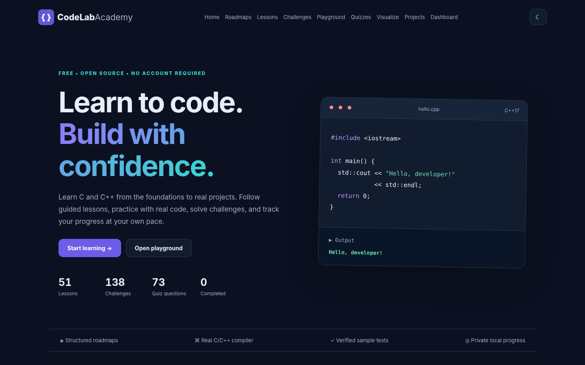

# CodeLab Academy

**Learn C and C++ — one concept and one program at a time.**



[**Visit the live website**](https://nittinchughani.github.io/codelab-academy/) · [Report a problem](https://github.com/NittinChughani/codelab-academy/issues) · [Contribute](CONTRIBUTING.md)

CodeLab Academy is a free, open-source, mobile-friendly learning site for C and C++. No accounts, build tools or database are necessary. Created with HTML, CSS and vanilla JavaScript.

## What's included

| Area | Content |
| --- | --- |
| Courses | **51 lessons** in C and C++, with explanations, examples, tips and exercises |
| Programming challenges | **138 exercises** (69 problem types, each implemented in C and C++), with sample input/output, hints and working reference code |
| Quizzes | **73 questions** with detailed explanations, shuffled choices, topic filters, retries and best-score tracking |
| Projects | **12 guided mini-projects** with milestones, acceptance criteria and starter templates |
| Visual learning | Step-by-step loops, clickable array indices and a pointer/reference illustration |
| Playground | Editable, syntax-highlighted C/C++ code, stdin, output, examples, reset, copy, and remote compilation |
| Dashboard | Completed lessons, saved lessons, quizzes, tested challenges, projects, backup/export and restore/import |
| Design | Dark/light themes, mobile layout, keyboard-friendly controls and clear feedback |

The course includes easier and more advanced tasks, but the material is designed for learning, not as a certified exam.

## Running the website locally

Simplest option: open `index.html` in a modern browser. For the most consistent development behavior, serve the files locally:

```bash
python3 -m http.server 8000
```

Open `http://localhost:8000`.

No `npm install`, npm dependencies, configuration file, database, or API key is required to browse the course. **Running actual C/C++ programs in the playground does require internet access to Wandbox.**

## How the C/C++ compiler works

GitHub Pages is static hosting and cannot itself execute C/C++ programs. Clicking **Run code** sends the code and optional standard input to [Wandbox](https://wandbox.org/) (`/api/list.json` and `/api/compile.json`). Wandbox uses a separate remote sandbox to compile and execute programs and returns compiler diagnostics and output. Code is **not submitted just by opening the page**. No API key is embedded.

The UI selects an available GCC compiler from the current catalog, displays errors if compilation fails, and provides a manual fallback when the third-party service is unavailable. Remote execution is subject to Wandbox availability, browser CORS policies, third-party privacy terms and service limits. Do not send secrets or private data. We do **not** guarantee continuous public compilation availability. For frequent/production usage, deploy your own appropriately sandboxed compile service.

Challenge checking compares **only the first supplied sample case**, using normalized whitespace and actual compiler stdout. A passing sample demonstrates only that case; it does **not** prove a solution is correct for all inputs. Hints and reference solutions are available for education.

For step-by-step **browser-only replacement** of an existing CodeLab Academy repository, see [UPLOAD_TO_GITHUB.md](UPLOAD_TO_GITHUB.md).

## GitHub Pages deployment

1. Open your repository on GitHub.
2. Use **Add file → Upload files** and upload the *contents* of this project folder, not the ZIP itself. Preserve `assets/`, `docs/`, `scripts/` and `.github/` folder paths.
3. Review the listed destination paths before committing: `index.html` and `README.md` belong in the repository root, while `assets/app.js`, `assets/data.js`, `assets/challenges.js`, `assets/projects.js`, `assets/style.css` and `assets/favicon.svg` belong under `assets/`.
4. Commit the changes. If your repository is already enabled for GitHub Pages, its existing configuration should continue to work.
5. If Pages is not configured: **Settings → Pages → Deploy from a branch → main → / (root) → Save**.
6. Refresh the published site after the deployment completes. Use a hard refresh if an older cached copy appears.

**If GitHub's browser uploader skips a folder**, drag the folder into the upload area rather than choosing only the loose files. The `.github` folder contains optional automation and issue templates; the live website does not depend on it. GitHub may require you to create hidden-folder paths manually.

## Project structure

```text
codelab-academy/
├── index.html
├── assets/
│   ├── app.js                # Browser UI, navigation, quiz, editor, progress
│   ├── data.js               # 51 lessons, 73 quiz questions
│   ├── challenges.js         # 138 original language-specific exercises
│   ├── projects.js           # 12 guided mini projects
│   ├── style.css             # Responsive styling and both themes
│   └── favicon.svg
├── docs/
│   ├── CURRICULUM.md
│   ├── DEVELOPMENT.md
│   └── preview.png
├── scripts/
│   └── check-content.cjs
├── .github/
│   ├── workflows/validate.yml
│   ├── ISSUE_TEMPLATE/
│   └── PULL_REQUEST_TEMPLATE.md
├── UPLOAD_TO_GITHUB.md
├── CONTRIBUTING.md
├── CODE_OF_CONDUCT.md
└── LICENSE
```

## Progress and privacy

The website stores progress in your browser's `localStorage` key `codelab-academy-complete-v2`. When you first upgrade from the original website, it attempts to import completed lessons, bookmarks, quiz best scores and practiced exercises from the earlier local storage keys. **Keep using the same website URL and browser profile** so this migration can work.

Click **Dashboard → Export progress** to download a JSON backup. **Import progress** can restore it on another browser/device. The site has no account system, server-side tracking or analytics. Only using the remote compiler sends code/input to Wandbox.

## Tests

```bash
node --check assets/data.js
node --check assets/challenges.js
node --check assets/projects.js
node --check assets/app.js
node scripts/check-content.cjs
```

`check-content.cjs` verifies data format, unique IDs, sample cases and expected HTML elements. The GitHub Actions workflow runs it on pushes and pull requests. Before publishing UI changes, manually check the site in a desktop and mobile browser. See [docs/DEVELOPMENT.md](docs/DEVELOPMENT.md).

Challenge reference solutions were locally compiled with GCC / G++ and checked against their sample cases when this release was prepared. Remote Wandbox execution was tested with simulated API responses in a browser; actual public service availability can vary.

## Contributing

Corrections, better explanations, accessibility improvements, bug reports and new original tasks are welcome. See [CONTRIBUTING.md](CONTRIBUTING.md) and [CODE_OF_CONDUCT.md](CODE_OF_CONDUCT.md).

**License:** MIT — see [LICENSE](LICENSE). Unless otherwise stated, educational examples in this project are original content.
